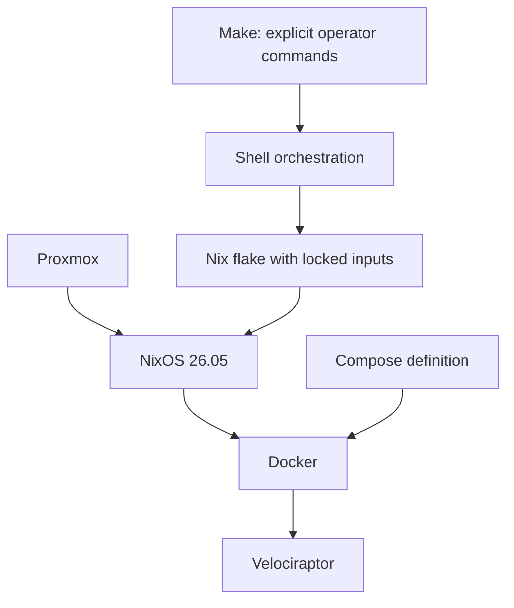

# Architecture

## Multi-service extension

NIX-VLR's online, destructive rebuild and diagnostic lifecycle has passed real
Proxmox acceptance, as reported by the operator. That report supersedes the older
pending-bootstrap statements retained below as development history. This branch
preserves the VLR contract and introduces NIX-IRIS through shared controllers and
service hooks. **NIX-IRIS has now also been live validated on real Proxmox**:
fresh installation completed; a failed initial release was recovered
non-destructively with `make iris-online`; `iris-online`, `rebuild-iris-online`
and the post-rebuild `diagnose-iris-online` all passed, including persistent
DATA and identity/secret-fingerprint survival across the OS rebuild. A
post-IRIS `make diagnose-vlr-online` also passed, confirming the shared
controller/VM/trust/SSH path did not regress VLR. See
[the live validation record](validation.md) for the exact result and scope.

See [NIX-IRIS and reusable lifecycle](nix-iris.md) for architecture, exact VM/network
and DATA layout, runtime-only secret generation, security controls, operations,
validation results and remaining hardening work. The detailed
VLR-specific material below continues to apply to VM 106.



Proxmox supplies one x86_64 virtual machine. NixOS declares the guest OS, networking, SSH, Docker and the systemd unit. Docker runs the application image; Compose describes its ports and two persistent bind mounts. Make selects a readable shell script. No service depends on Codex.

## What the tools mean

A **Nix flake** is the repository's entry point: `flake.nix` declares inputs and outputs. `flake.lock` pins exact source revisions and hashes, including stable `nixos-26.05`. The `nixos-anywhere` package comes from that pinned nixpkgs input. The lock pins its package implementation too.

Pure `nix flake check` checks scripts and baseline module properties without requiring deployment values. The deployable `nixosConfigurations.nixos-vlr` output appears only when preflight-supplied public `FAK_VLR_CONFIG` JSON is visible under `--impure`. This small explicit environment boundary avoids committing machine-specific configuration or making up values. It is not a secret channel.

**Disko** declares partitions for the disposable OS disk: GPT, a 512 MiB FAT EFI partition, and the remaining space as ext4 root. Its configuration contains exactly one disk. **nixos-anywhere** runs that disk layout and installs a locally built NixOS closure through SSH to a live installer. It does not manage Proxmox VMs. Installation scripts skip kexec. The FAK controller builds/boots a separate pinned installer ISO, verifies its SSH key through the Proxmox guest agent, then restores OS-first boot before installation.

**Docker Compose** pins the image by repository, approved release tag and sha256 digest. An explicit `/bin/velociraptor` entrypoint starts the frontend with an existing configuration. systemd checks the persistent mount and identity before starting attached Compose. Docker Compose retains `restart: "no"`; systemd is the single service supervisor with `Restart=on-failure` and `RestartSec=5`. Failed service/container exits trigger a restart after five seconds, and every restart reruns the existing preStart mount, identity and Compose validation guards. `make vlr-online` and operator-initiated service restarts use those same guards.

## Network and VM

The table below describes VLR's real, currently deployed shape, including its second (INTERNET) NIC. That second NIC is not the platform's target going forward: the default for every service is single-NIC (`vmbr1` only, static `10.10.20.x`), with no service exception since MISP became single-NIC on 2026-10-05. See [network-nic-policy.md](network-nic-policy.md) for the policy, the shared-code mechanism, and VLR/IRIS's migration plan -- this table is updated to match once that migration actually happens, not before.

| Setting | Value |
| --- | --- |
| Hostname/timezone | `nixos-vlr`, `America/Toronto` |
| LAN | `vmbr1` -> `net0` -> `ens18`, static service address `10.10.20.106/24` |
| INTERNET | `vmbr0` -> `net1` -> `ens19`, DHCPv4 / normal default route |
| Routing/DNS | Explicit operator choice; no guessed gateway or DNS |
| VM | q35, OVMF/UEFI, VirtIO SCSI single, host CPU |
| Capacity | 4 vCPU, 8192 MiB RAM, 60 GiB OS disk |
| NICs/agent | Two VirtIO NICs; QEMU guest agent enabled |
| Application | HTTPS frontend 8000 and GUI 8889 bound on service IP |

DHCP routes are accepted only when the operator chooses `ens19` as default-route interface. If `ens18` is chosen, a service-subnet gateway is mandatory and Internet DHCP routes are disabled. DHCP DNS is a separate explicit choice. IPv6 router advertisements are disabled so they cannot introduce an unintended default route.

### VMID scheme

Every FAK guest has one fixed Proxmox VMID, and every service's static address on `vmbr1` is `10.10.20.<VMID>`: the VMID is the last octet. There is one exception: OPNsense, the `vmbr1` gateway, is VMID 102 but its LAN is `10.10.20.1` (the gateway convention), not `.102`. This table is where VMIDs are allocated: record a new one here before using it. What is actually deployed is in "Deployed state on viper4" below the table.

| VMID | Guest | Kind | Proxmox name | VMID before 2026-10-05 |
| --- | --- | --- | --- | --- |
| **100** | **FAK-AUTOMATION -- permanently reserved** (the controller; running, promoted 2026-10-07: see "Deployed state" below) | VM | FAK-Auto | 110 |
| 101 | FAK-REPO | LXC container (`pct`, not `qm`) | FAK-Repo (label; the container is `fak-repo`) | 108 |
| 102 | OPNsense, LAN `10.10.20.1` (the gateway convention, not the VMID convention; operator, 2026-10-01) (running at VMID 102 on viper4 since 2026-10-06, 26.7.5; deployment design [opnsense-deployment.md](opnsense-deployment.md), creation and checks [automation-create-guest-opnsense.md](automation-create-guest-opnsense.md)) | VM (`qm`), FreeBSD-based appliance, deliberately two NICs | FAK-OPNSense | 100 |
| 103 | Reserved: Security Onion Manager (not built; nothing in this repository creates or configures it) | -- | FAK-SO-Manager | -- |
| 104 | Reserved: Security Onion Search (not built) | -- | FAK-SO-Search | -- |
| 105 | Reserved: Security Onion Sensor (not built) | -- | FAK-SO-Sensor | -- |
| 106 | NIX-VLR | VM | FAK-VLR | 104 |
| 107 | NIX-IRIS | VM | FAK-IRIS | 105 |
| 108 | NIX-MISP | VM | FAK-MISP | 106 |
| 109 | NIX-INTELOWL | VM | FAK-IntOwl | 107 |
| 110 | FAK-CHAT (Mattermost; decided 2026-10-01, deployed on viper4 2026-10-07: [nix-chat.md](nix-chat.md)); `10.10.20.110` | LXC container (`pct`, not `qm`) | `nixos-chat` (a container's Proxmox name is its hostname; FAK-CHAT is its Proxmox description) | 112 |
| 998 | Reserved: FAK-REPO's rebuild holding container (operator, 2026-10-10: [fak-repo.md](fak-repo.md), Rebuild). Exists only while `make rebuild-fak-repo-online` runs, or after one that stopped part-way (which the next run does not resume): it holds the mirror volume while container 101 is destroyed and created again. No NIC and no address, never started; nothing else may use the ID | LXC container | `fak-repo-hold` | — |

**Renumbered 2026-10-05 (operator decision): in the repository that day, on viper4 by 2026-10-07.** Every guest's VMID and `vmbr1` address changed as the last column shows, so that the IDs run 100 to 110 in one block and each address ends in its VMID. No guest keeps its old ID, and several old IDs now belong to a different service (104 to 108 and 110 especially), so nothing can be renumbered in place: a guest created under the old numbers has to be recreated at its new ID and address. The documents in this repository were renumbered with the code, including their dated records, so a record written before 2026-10-05 names today's ID for the guest it is about, while Proxmox's own task history from that time shows the old one. NIX-PORTAL and NIX-BROKER, which the old table listed as planned at 109 and 111, have no ID in the new scheme; allocate one here if either is taken up.

### Deployed state on viper4, 2026-10-07

Read from the host that day (`qm list`, `pct list`, read-only), with what was checked for each guest. This is a dated
record, not something the repository enforces: re-read the host before relying on it.

| Proxmox name | VMID | State | Last checked on real infrastructure |
| --- | --- | --- | --- |
| `FAK-Auto` | 100 | running | Controller, promoted for all four guests. `make diagnose-controller-authority` from the workstation exits 0 at commit `a6ff064`: repository revision, keys, the four trust files, VMs 106 to 109 over Role C, the four guests over Role D with their dedicated authorization files, and the authority marker. The old controller, VM 110 `nixos-automation`, was destroyed the same day. |
| `FAK-OPNSense` | 102 | running | `make validate-opnsense-online` passes in full, NTP included. Moved from VMID 100 on 2026-10-06. |
| `FAK-VLR` | 106 | running | Converged from VM 100 (`make vlr-online`, then `make diagnose-vlr-online`) at `ae0d98d`. |
| `FAK-IRIS` | 107 | running | Converged from VM 100 (`make iris-online`, then `make diagnose-iris-online`) at `ae0d98d`. |
| `FAK-MISP` | 108 | running | Converged from the workstation (`make misp-online`) at `ae0d98d`. Reachable from VM 100 over Role D; not yet recorded as converged from VM 100. |
| `FAK-IntOwl` | 109 | running | Converged from the workstation (`make intelowl-online`) at `c9c52cf`. Reachable from VM 100 over Role D; not yet recorded as converged from VM 100. |
| `fak-repo` | 101 | running | Created by `make fresh-fak-repo-online` on 2026-10-07, its first run on real infrastructure. `make validate-fak-repo-online` exits 0 from the workstation (2026-10-08). [fak-repo.md](fak-repo.md). |
| `nixos-chat` | 110 | running | Created by `make fresh-mattermost-online` on 2026-10-07, after a first attempt failed at the release and was fixed ([nix-chat.md](nix-chat.md), "The release guard"). `make validate-mattermost-online` exits 0 from the workstation. |
| `FAK-Analyst` | 155 | running | Not a FAK guest of this table: a second workstation ([quickstart.md](quickstart.md)). Nothing in this repository creates, configures or checks it. One file in it is written (operator, 2026-10-13): FAK-REPO's fresh deployment and rebuild put container 101's new SSH host key into its `known_hosts.fak-repo-installed` through the guest agent, when `FAK_ANALYST_VM_ID` is set ([fak-repo.md](fak-repo.md), "FAK-Analyst's copy of the host key"). Not yet run against the VM. |

**Controller authority covers VLR, IRIS, MISP and IntelOwl**, in the code
([fak-automation.md](fak-automation.md), "Four guests under the controller"; merged 2026-10-07 as `a6ff064`) and on
VM 100, which was first promoted for VLR and IRIS at `ae0d98d` and then enrolled for all four at `a6ff064` the same
day. FAK-REPO, FAK-CHAT and OPNsense are not under it.

**Two things about that state that the checks do not show:**

- **Time.** The guests take their time from OPNsense (`10.10.20.1`). OPNsense reaches no time server: NTP to the
  internet and to `10.40.0.6` is blocked upstream of viper4, and viper4's own clock is unsynchronised for the same
  reason. OPNsense therefore serves its own clock (stratum 12, ntpd's orphan mode), and the guests report
  "synchronized" against that. They agree with each other, not necessarily with real time.
- **The marker is one commit old as soon as main moves.** `make diagnose-controller-authority` from a workstation ahead
  of `a6ff064` fails on the revision and the marker until VM 100 is updated and its marker rewritten: `make update-controller`
  ([fak-automation.md](fak-automation.md), "After a merge").

**The Proxmox name is a display name, separate from everything else that identifies a guest.** For the six VMs it is what `qm create --name` sets and what the lifecycle checks compare (`vm_name` in `deploy/service.py` and `deploy/native-controller.py`, `constants.name` in `deploy/guest_kinds.py`, `EXPECTED` in `deploy/automation-bootstrap.py`). The guest's own hostname (`nixos-vlr`, `nixos-misp`, ...), slugs, disk serials, labels and `WIPE-...` confirmations are unchanged. A container's Proxmox name is its hostname, so FAK-REPO and FAK-CHAT keep `fak-repo` and `nixos-chat` there, and FAK-Repo and FAK-CHAT are labels only. FAK-CHAT was called NIX-CHAT until 2026-10-07; its slug (`nix-chat`), hostname and `FRESH-NIX-CHAT` confirmation keep that name ([nix-chat.md](nix-chat.md)). A VM created under its old name (`nixos-...`) is refused by the lifecycle checks ("VM name differs") until it is renamed (`qm set <vmid> --name <name>`) or recreated.

**100 is permanently reserved for FAK-AUTOMATION**, the controller VM ([fak-automation.md](fak-automation.md)). Never assign 100 to any other guest.

**103 to 105 are reserved for Security Onion and nothing more.** No configuration, registry entry, host or script exists for it; building it needs operator approval and its own design first.

Little in code enforces this table. VLR and IRIS pin their VMIDs in `deploy/service.py`. FAK-REPO's configuration loader (`tests/fak-repo-config.py`) refuses `PROXMOX_VM_ID=100` in both scopes, and in its deployment scope refuses a `FAK_REPO_SERVICE_ADDRESS` that is not `10.10.20.<PROXMOX_VM_ID>/24` (a VMID outside 100 to 254 has no such address); its creation scope keeps accepting any VMID, because the disposable container of [role-c-container-live-verification.md](role-c-container-live-verification.md) is 991. FAK-REPO's fresh creation (`deploy/fak-repo-controller.py`) pins 101 itself and refuses any other ID. Every other service's `PROXMOX_VM_ID` (including the automation controller's, which [fak-automation.md](fak-automation.md) describes as operator-configured) is validated for form only, so a wrong or duplicate ID would not be rejected there. Nothing checks that two services do not share a VMID. Beyond FAK-REPO's loader, the table is kept by review.

## Storage boundary

```mermaid
flowchart LR
    A[FAK-VLR-OS] --> B[Disko: EFI and root]
    C[FAK-VLR-DATA] --> D[ext4 label VLR-DATA]
    D --> E[/opt/velociraptor]
    E --> F[etc: server config and identity secrets]
    E --> G[datastore: application state]
    E --> H[.fak: non-secret identity metadata]
```

Proxmox disk serials must be `FAK-VLR-OS` and `FAK-VLR-DATA`. The operator supplies the actual corresponding guest by-id paths. Runtime checks compare the mounted device, serial and label; installer checks additionally refuse mounted disks or active holders. DATA is a whole-disk ext4 filesystem, outside Disko. The VM creator only allocates blank virtual disks. Filesystem initialization exists only in the fresh flow.

Sources: [Disko](https://github.com/nix-community/disko), [nixos-anywhere CLI](https://github.com/nix-community/nixos-anywhere/blob/main/docs/cli.md), [upstream Velociraptor Docker deployment](https://docs.velociraptor.app/docs/deployment/server/docker/). Velociraptor remains 0.77.2 at the existing operator-approved digest. Bootstrap uses locally installed Proxmox interfaces only.
